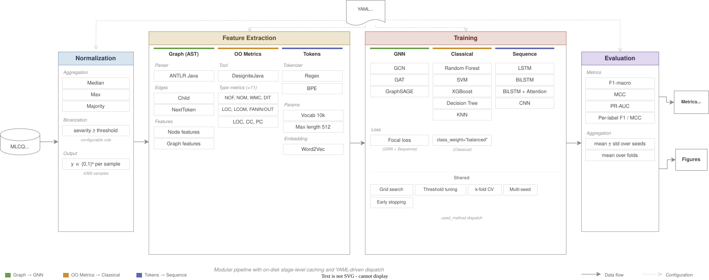

# DETECT

**DE**sign defec**T** **E**valuation and **C**lassification **T**oolkit for code smell detection.

A unified pipeline that evaluates classical ML, sequence DL and graph neural network models under identical preprocessing, label definitions and evaluation protocols. Three model families, one entry point, YAML-driven configuration.

Currently supports the [MLCQ](https://zenodo.org/records/3666840) dataset. Integration of [DaCoSX](https://zenodo.org/records/7570428) and support for alternative binarization protocols (Madeyski DS1/DS2) are ongoing.



## Setup

```bash
git clone https://github.com/Kheims/DETECT.git && cd DETECT
uv sync
```

Requires Python 3.13+, Java 17+ (for DesigniteJava) and [uv](https://docs.astral.sh/uv/).

## Reproducing the paper results

Each experiment is one command. The pipeline caches intermediate stages so only the first run per family pays the full cost.

The 17 models share one protocol: the same snippets (those with an AST), the same folds (10 seeds x 5 stratified folds, written once by the folds stage), a grid or an early stopping decided on the validation part, and one threshold per smell tuned on the validation part.

### Classical ML (8 models)

```bash
for model in rf svm xgboost dt knn j48 mlp nb; do
  uv run python main.py --config config/experiments/classical_${model}_pipeline.yml
done
```

Extracts 21 OO metrics via DesigniteJava. Each run fits every point of the grid on the training part and keeps the one with the best PR-AUC on the validation part.

### Sequence DL (6 models)

```bash
for model in lstm bilstm bilstm_plain gru cnn codebert; do
  uv run python main.py --config config/experiments/sequence_${model}_pipeline.yml
done
```

Reads each snippet as consecutive 512-token chunks (at most 3, 8 for CodeBERT), with a regex tokenizer (vocabulary of the training part, 10k) or the CodeBERT subword tokenizer. Each config runs 10 seeds x 5 folds on the shared folds of the folds stage, the same train, validation and test parts as the GNN runs. Focal loss and early stopping on the validation macro F1, BCE and early stopping on the validation average precision for CodeBERT. GPU recommended: CodeBERT takes about 3 h per seed on a V100.

### GNN (3 architectures)

```bash
for model in gcn gat graphsage; do
  uv run python main.py --config config/experiments/gnn_${model}_pipeline.yml
done
```

Parses each snippet into an AST with ANTLR Java 8 and builds PyTorch Geometric graphs. Each config holds the best setting of its architecture: Child and NextToken edges with focal loss for GCN and GAT, Child edges with weighted BCE for GraphSAGE.

### Scores of the 17 models

```bash
uv run python scripts/cv/eval_eligible.py --config config/experiments/benchmark.yml
uv run python scripts/cv/summarize_cv.py artifacts/benchmark \
  --folds artifacts/cache/folds/<fingerprint>/folds.json --baseline codebert
```

Each smell is scored on the snippets of its level: methods for Feature Envy and Long Method, classes for Blob and Data Class. The summary gives the mean MCC of each model over the 50 runs with its 95% interval, and the paired differences with the baseline (corrected resampled t-test).

### Other labels, other snippets

The labels come from the normalization stage, so one override changes them for the three families. Give each series its own artifacts folder.

```bash
# Madeyski DS2: major and critical only
uv run python main.py --config config/experiments/gnn_gcn_pipeline.yml \
  --run.artifacts_root=artifacts/ds2 --normalization.rule=ds2

# positive when more than half of the reviews see the smell
uv run python main.py --config config/experiments/gnn_gcn_pipeline.yml \
  --run.artifacts_root=artifacts/majority --normalization.method=majority

# the complete dataset: 4,770 snippets (data/mlcq_complete, built by scripts/data/build_mlcq_complete.py)
uv run python main.py --config config/experiments/gnn_gcn_pipeline.yml \
  --run.artifacts_root=artifacts/complete --normalization.input_json=data/mlcq_complete/MLCQCodeSmellSamples.json
```

On a Slurm cluster, `scripts/slurm/submit_benchmark.sh <artifacts folder> [overrides]` submits the 17 models of a series.

### Generate figures

```bash
uv run python scripts/report_runs.py --artifacts-root artifacts
```

## Changing things

Any YAML key can be overridden from the command line. The pipeline re-runs only the affected stages.

```bash
# Larger hidden layer, fewer seeds
uv run python main.py --config config/experiments/sequence_lstm_pipeline.yml \
  '--training.hidden_dim=512' \
  '--ablation.seeds=[42,43]'

# Custom hyperparameter grid
uv run python main.py --config config/experiments/classical_xgboost_pipeline.yml \
  '--training.param_grid.n_estimators=[50,100,500]' \
  '--training.param_grid.max_depth=[3,5,10]'

# Force rebuild (ignore cache)
uv run python main.py --config config/experiments/classical_rf_pipeline.yml \
  '--run.force_rebuild=true'
```

Config files inherit from `config/defaults.yml`.

## Pipeline stages

**Normalization** -- Aggregates multi-reviewer annotations into binary labels. Default: median severity, positive if severity > none. Configurable aggregation (median, majority, max) and rules (default, ds1, ds2). When enabled, every later stage reads its labels.

**Metric extraction** -- DesigniteJava extracts 11 type-level metrics (NOF, NOM, WMC, DIT, LCOM, FANIN, FANOUT, ...) and 3 method-level metrics (LOC, CC, PC) aggregated by max/sum/avg plus method count. 21 features total.

**Token dataset** -- Regex tokenizer splits code into identifiers, keywords, operators, literals. Vocabulary built from training data, sequences padded/truncated to fixed length. Optional Word2Vec pre-training.

**AST construction** -- ANTLR Java 8 grammar parses each snippet into a syntax tree with 202 node types. Exports as DOT, converted to PyTorch Geometric Data objects.

**Folds** -- Train, validation and test parts of every (seed, fold), built once over the snippets that have an AST with the splitter of the GNN runs. 10 seeds x 5 stratified folds by default. The sequence models read them, so every family is tested on the same snippets.

**Training** -- Dispatches based on `training.used_method` (classical, sequence, chunked_sequence, gnn, codebert). Multi-seed evaluation, per-label threshold tuning, focal loss for DL models.

**Caching** -- SHA-256 fingerprint per stage. Unchanged stages are skipped across runs.

## Project structure

```
main.py                             # entry point
pyproject.toml                      # dependencies, locked in uv.lock
config/
  defaults.yml                      # all default parameters
  experiments/                      # one YAML per experiment
  ablations/                        # GCN model and feature ablation
mlcq_graphs/
  pipeline.py                       # stage orchestrator + caching
  config.py                         # YAML includes and CLI overrides
  constants.py                      # label order and edge types
  token_encoder.py                  # Word2Vec on AST token sequences
  metamorphic.py                    # transforms that keep or change a smell
  reporting.py                      # training and ablation figures
  visualization.py                  # PR, ROC, F1 and confusion plots
  models/                           # classical, sequence, GNN, genetic, fusion
  training/                         # focal loss, weighted BCE, plain BCE
  evaluation/                       # metrics, threshold tuning, shared CV
  stats/                            # paired t-test and Wilcoxon
  xai/                              # helpers of the interpretability scripts
scripts/
  NormalizeFromJson.py              # reviewer aggregation + binarization
  extract_designite_metrics.py      # batched DesigniteJava
  build_token_dataset.py            # tokenizer
  build_ast_dot_from_normalized.py  # ANTLR parsing
  build_pyg_dataset_from_dot.py     # DOT to PyG
  train_classical.py                # sklearn training
  train_sequence.py                 # PyTorch sequence training
  train_chunked_sequence.py         # sequence models and CodeBERT on 512-token chunks, shared folds
  train_codebert.py                 # CodeBERT fine-tuning
  train_gcn_baseline.py             # GNN training, run by the pipeline
  train_gcn_baseline.slurm          # cluster job for the GNN training
  train_genetic.py                  # genetic algorithm on OO metrics
  report_runs.py                    # tables + figures
  plot_confusion_matrices.py        # confusion matrices of every family
  data/                             # DACOS, SmellyCode++ conversion, features
  cv/                               # shared folds, model runs and tables
  pretraining/                      # self-supervised GNN pre-training, DDP
  llm/                              # LLM judges, context study, routing
  labels/                           # label analyses, reviewer agreement
  analysis/                         # size control, transfer, PMD, metamorphic
  xai/                              # attributions of the detectors
  slurm/                            # cluster job scripts
prompts/                            # prompts of the LLM judges
tests/                              # metamorphic and LLM context tests
tools/
  designite.jar                     # metric extraction
  antlr/                            # Java grammars + generated parser
docs/                               # pipeline diagram
data/                               # MLCQ, raw and normalized
artifacts/                          # outputs, not in the repository
```


